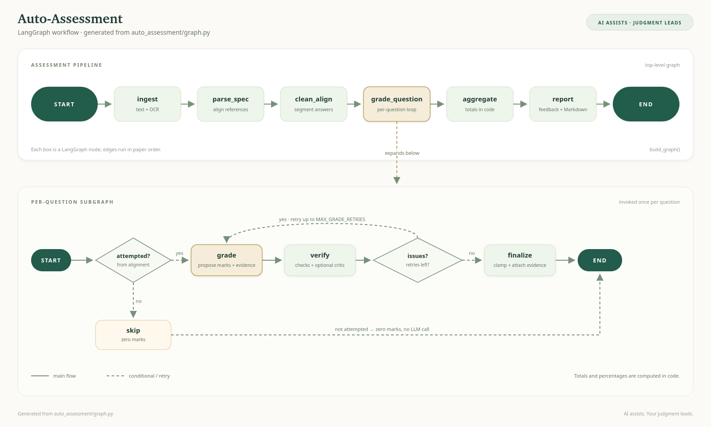

# Auto-Assessment

Agentic grading for handwritten, scanned, and typed answer sheets.

Auto-Assessment reads a question paper, model answers, optional marking rubric, and
student answer sheets, then produces per-question marks, criterion-level evidence,
and actionable feedback. Grading is orchestrated with LangGraph, model calls use
LangChain, and the web UI streams progress while the pipeline runs.




<sub>[Open the diagram full size](static/img/langgraph-architecture.png)</sub>

---

## Key features

- **Rubric-grounded grading.** Explicit criterion marks are enforced; the app never
  invents or rescales allocations. Without a rubric, each question is graded as a
  whole against its model answer.
- **Verifiable marks.** Every awarded criterion must quote the student's answer
  verbatim, and the quote is fuzzy-matched in code. Marks are clamped to rubric
  bounds and totals are always computed by code.
- **Independent verification.** Deterministic checks run first; an optional LLM
  critic then reviews fairness and feedback specificity. Failed questions retry and
  are flagged for human review instead of being silently accepted.
- **Multilingual by default.** Source text and feedback keep the question paper's
  language and script; report headings are localized too.
- **Browser workflow.** Upload materials, watch per-question progress, then inspect
  a review sheet with search, filters, sorting, and print/CSV/Markdown/JSON exports.
- **Provider flexibility.** Grade with local Ollama or OpenRouter. PDF/image OCR is
  always sent to OpenRouter (see [Document extraction](#document-extraction)).
- **Docker-ready.** Single-stage `Dockerfile`, non-root runtime, healthcheck, and a
  Compose file with loopback-only publishing.

---

## How it works

| Stage | Responsibility |
|---|---|
| `ingest` | Read `.txt`/`.md` directly. Send each PDF/image unchanged to OpenRouter OCR/vision and preserve document order. |
| `parse_spec` | Align the question paper, optional rubric, and model answers into an `ExamSpec`. Validates ids, marks, and criterion coverage. |
| `clean_align` | Split the transcript into one verbatim answer per question. Missing, duplicated, contradictory, or ungrounded alignments are withheld for review. |
| `grade_question` | Run the per-question sub-graph in paper order. Unattempted or failed questions are recorded without calling the model. |
| `grade` | Propose criterion marks, verbatim evidence, strengths, gaps, and improvements. |
| `verify` | Apply deterministic checks, then the optional LLM critic. Retry while issues remain. |
| `finalize` | Clamp marks, drop ungrounded credit, and keep unresolved notes for the reviewer. |
| `aggregate` | Sort grades into paper order and compute totals and percentages in code. |
| `report` | Write localized overall feedback and render the Markdown report. |

### Document extraction

- `.txt` / `.md` files and pasted model answers need no OCR.
- PDFs are sent whole to OpenRouter's `file-parser` plugin using `mistral-ocr`.
- Images (PNG, JPEG, WebP, GIF) are sent to the configured OpenRouter vision model.
- There is no local PDF rendering, image conversion, or OCR fallback.
- `OPENROUTER_API_KEY` is therefore required for any PDF or image upload, even when
  grading with Ollama. OCR usage may incur OpenRouter charges.
- Diagrams, graphs, and tables are converted to structured text during OCR; they are
  graded from that text, not from image crops.

---

## Requirements

- **Python 3.12** (the Docker image uses `python:3.12-slim`)
- **OpenRouter API key** for PDF/image OCR and, optionally, OpenRouter grading
- **Ollama** (optional) for fully local text grading
- **Docker** (optional) for containerized deployment

---

## Quick start (local)

```bash
python3.12 -m venv .venv
source .venv/bin/activate
pip install -r requirements.txt

cp .env.example .env
# Edit .env: set LLM_PROVIDER and OPENROUTER_API_KEY as needed.
```

For local Ollama grading:

```bash
ollama pull qwen2.5:14b
python app.py
```

Open <http://127.0.0.1:8001>. The Flask app binds to loopback only by default.

For OpenRouter grading, set these in `.env`:

```dotenv
LLM_PROVIDER=openrouter
OPENROUTER_API_KEY=sk-or-...
```

---

## Docker

```bash
docker compose up -d --build
docker compose logs -f
open http://127.0.0.1:8001
docker compose down
```

The Compose file:

- publishes the app on `127.0.0.1:8001` only, because the UI has no authentication;
- passes `.env` values into the container;
- maps `host.docker.internal` so the container can reach Ollama on the host;
- stores uploads in a size-limited `/tmp` tmpfs and removes them after each run.

If Ollama runs in another Compose service, set its service URL instead of the host
gateway, for example:

```bash
DOCKER_OLLAMA_BASE_URL=http://ollama:11434 docker compose up -d --build
```

To run tests inside the built image:

```bash
docker compose run --rm app python -m pytest -q
```

---

## Configuration

Settings are read from environment variables or a local `.env` file. See
[`.env.example`](.env.example).

| Variable | Default | Purpose |
|---|---|---|
| `LLM_PROVIDER` | `ollama` | Text provider: `ollama` or `openrouter`. |
| `OPENROUTER_API_KEY` | — | Required for PDF/image OCR and OpenRouter grading. |
| `OPENROUTER_MODEL` | `openai/gpt-4o` | Text model used when `LLM_PROVIDER=openrouter`. |
| `OPENROUTER_VISION_MODEL` | `mistralai/mistral-small-3.1-24b-instruct` | OCR/vision model for PDFs and images. |
| `OLLAMA_BASE_URL` | `http://localhost:11434` | Local Ollama endpoint. |
| `OLLAMA_MODEL` | `qwen2.5:14b` | Local text model. |
| `OLLAMA_NUM_CTX` | `8192` | Ollama context window. |
| `USE_CRITIC` | `true` | Run the LLM critic after deterministic checks. |
| `MAX_GRADE_RETRIES` | `2` | Retry budget for a question that fails verification. |
| `EXTRACTION_REASONING` | `false` | Enable model reasoning for extraction/alignment calls. |

The web form can override the provider, models, retry count, and critic toggle for a
single run.

---

## Usage

### Web UI

1. Upload a question paper, optional rubric, model answers (file or pasted text), and
   one or more student answer sheets.
2. Choose the provider and verification settings, then start the assessment.
3. Follow the **Grade & verify** progress bar; uploads are deleted when the run ends.
4. Open **Show reviews** for the review sheet. Results live in the current browser
   tab (`sessionStorage`) until the tab is closed or **Clear & start new** is used.
5. Download `report.md`, `result.json`, or `scores.csv`, or print the filtered list.
6. Open **How it works** in the sidebar for a visual walkthrough of the pipeline.

Uploads are limited to 50 MB per request. Supported formats: PDF, TXT, MD, PNG,
JPEG, WebP, GIF.

### CLI

```bash
python -m auto_assessment.cli \
    --question-paper examples/example_0_texts/question_paper.txt \
    --model-answers examples/example_0_texts/model_answers.txt \
    --rubric examples/example_0_texts/rubric.txt \
    --answers examples/example_0_texts/student_answer.txt
```

Pass `--no-critic` to skip the second-opinion model, `--provider` to override the
provider, and `--out DIR` to change the output directory.

### Bundled example

```bash
python run_pipeline.py
```

This runs the `examples/example_0_texts` files and writes to
`out/pipeline-test/`.

### Output files

The CLI writes:

| File | Contents |
|---|---|
| `report.md` | Localized, student-facing report. |
| `result.json` | Final result: totals, grades, criterion scores, warnings. |
| `questions.json` | Aligned question/answer dictionaries used for grading. |
| `transcript.txt` | Extracted student transcript. |

### Behaviour notes

- `python run_pipeline.py` writes the bundled example to `out/pipeline-test/`.
- Node logs show timings, output fields, question/attempt, and failures; student
  answers and model output are never logged.
- Review search, filters, sorting, jump links, expand/collapse, and print follow the
  filtered list; CSV, Markdown, and JSON exports always include every question.
- Required inputs: question paper, model answers (upload or pasted), and at least one
  answer sheet. The rubric is optional but supplied criteria need explicit marks;
  structured JSON spec input is unsupported.
- Results stay in the browser tab until cleared or closed. The server is
  loopback-only and unauthenticated; uploads are removed after processing.

---

## Project structure

```text
.
├── app.py                     Flask UI, upload validation, NDJSON streaming endpoint
├── run_pipeline.py            Runs the bundled example or forwards CLI arguments
├── auto_assessment/
│   ├── __init__.py            Public package exports
│   ├── config.py              Environment-backed Settings
│   ├── cli.py                 argparse CLI and artifact writer
│   ├── pipeline.py            Blocking and streaming public entry points
│   ├── graph.py               LangGraph workflow assembly and routing
│   ├── nodes.py               Top-level and per-question graph nodes
│   ├── models.py              Pydantic LLM schemas and graph state types
│   ├── prompts.py             All model prompts in one place
│   ├── ingest.py              Text reading and OpenRouter OCR/vision calls
│   ├── llm_client.py          Ollama/OpenRouter LangChain clients
│   ├── verify.py              Deterministic mark, evidence, and spec checks
│   ├── report.py              Markdown report renderer
│   ├── schemas.py             Compatibility re-exports from models.py
│   ├── state.py               Compatibility re-exports from models.py
│   └── llm.py                 Compatibility alias for create_llm
├── docs/                      Architecture diagram source (SVG)
├── templates/                 index.html, reviews.html, how_it_works.html
├── static/                    style.css, app.js, reviews.js, img/
├── examples/                  Text, image, PDF, and multilingual sample inputs
├── Dockerfile
├── docker-compose.yml
└── requirements.txt
```

---

## Grading safeguards

- Every awarded criterion requires a verbatim evidence quote that is fuzzy-matched
  against the student's answer.
- Marks are clamped to rubric bounds; totals and percentages are summed in code.
- The optional critic checks for credit without evidence and penalties for valid
  alternative answers.
- Questions that fail verification after retries are flagged in the UI and report.
- Unattempted questions receive zero marks without an LLM call and remain in the
  paper total.
- Uncertain transcription markers (`[illegible]`, `[?]`) trigger human review.
- The report model receives diagnostics and must translate every one; otherwise the
  run fails rather than hiding warnings. The report model never changes marks.

---

## Tests and evaluation

```bash
# Offline pipeline and web tests (model calls are mocked)
python -m pytest -q

# Review-sheet search/filter/export tests (optional; uses Node's built-in runner)
node --test tests/test_reviews.js

# Evaluation (requires real model access)
python evals/run_eval.py
```

`evals/run_eval.py` scores marks-in-bounds, total consistency, evidence grounding,
verification rate, agreement with human marks, and LLM-judged feedback quality. See
the module docstring for the dataset format.

---

## Limitations and security

- **Handwriting accuracy is the main risk.** OCR and grading can be wrong; review
  flagged questions before using marks.
- **OCR requires network access.** PDFs and images are sent to OpenRouter, even for
  local Ollama grading; there is no offline OCR path.
- **No authentication.** `python app.py` binds to `127.0.0.1`, and the Compose file
  publishes to loopback only. Add authentication and TLS before exposing the app to
  a network.
- **No server-side persistence.** Web results live in the browser tab; download the
  report before closing it.
- **Diagrams and tables are graded as OCR text.** There is no per-question visual
  re-check.
- **Provider behavior varies.** Model availability, pricing, and output quality
  depend on the selected Ollama or OpenRouter model.
